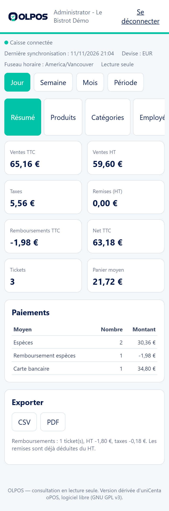
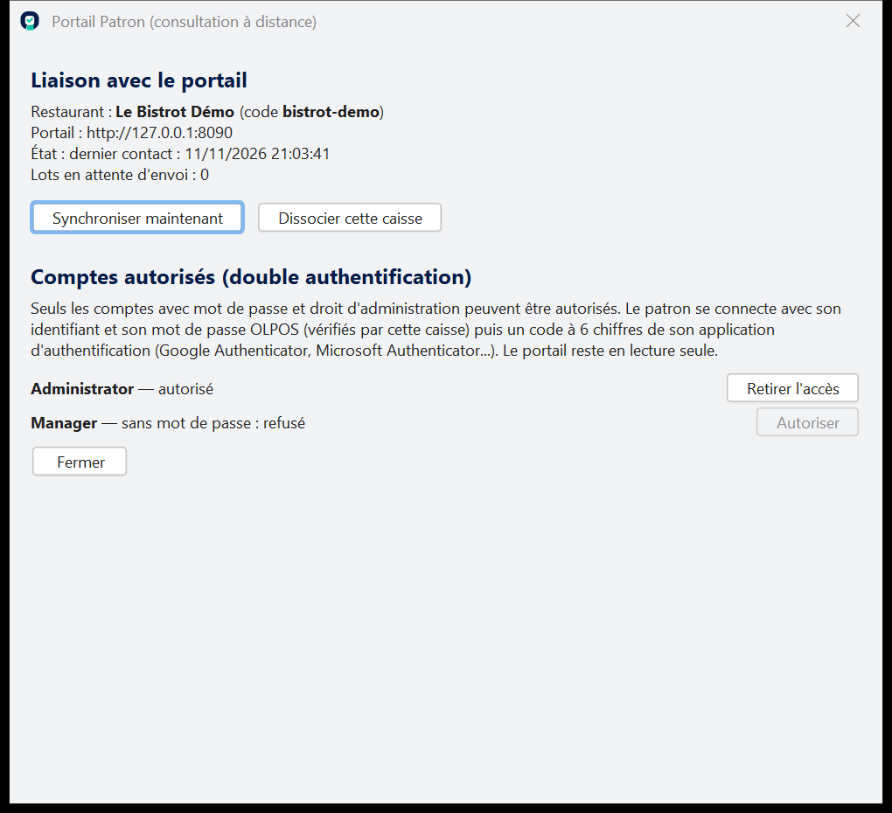

# Portail Patron OLPOS — consulter son restaurant à distance

Le **portail Patron** est un site web, consultable depuis un téléphone ou un
ordinateur, où le patron voit les ventes de son restaurant **en lecture seule** :
chiffre d'affaires, taxes, remises, remboursements, paiements, produits,
catégories, employés, jours et heures, tickets, clôtures de caisse, commandes en
cours, exports CSV et PDF.

> État actuel : **fonctionne et testé sur ce PC uniquement** (voir
> « Ce qui a été testé »). Aucun serveur n'est loué, aucun nom de domaine
> n'est acheté : la mise en ligne réelle reste à faire (voir « Mise en ligne »).



---

## 1. Comment ça marche (en clair)

```
 Téléphone du patron ──HTTPS──▶  Portail (serveur en ligne)  ◀──HTTPS (sortant)── Caisse OLPOS
                                   - stocke les chiffres                            - envoie les ventes
                                   - ne connaît AUCUN mot de passe                  - vérifie les mots de passe
```

* **La caisse se connecte elle-même au portail** (connexion sortante, HTTPS).
  Rien n'est ouvert sur Internet dans le restaurant, pas de redirection de port.
* Toutes les 60 secondes, la caisse envoie les nouvelles ventes encaissées,
  les clôtures et les commandes en cours. Sans Internet, **la caisse fonctionne
  normalement** : les envois attendent dans une file sur le disque
  (`%LOCALAPPDATA%\OLPOS5\portail\file\`) et partent au retour de la connexion,
  dans l'ordre, sans doublon.
* **Connexion du patron = le même identifiant et le même mot de passe que sur la
  caisse** (compte administrateur). Le **code à 6 chiffres** d'une application
  d'authentification (Google Authenticator, Microsoft Authenticator, etc.) est
  **facultatif** : il se choisit compte par compte à la caisse (« avec code »,
  recommandé, ou « mot de passe seul »).

### Le mot de passe ne passe jamais en clair par le portail

1. Le navigateur demande au portail la **clé publique de la caisse** et un défi
   à usage unique.
2. Le navigateur **chiffre** identifiant + mot de passe + code 2FA avec cette clé
   (RSA-OAEP SHA-256, fonction intégrée du navigateur). Seule la caisse peut
   déchiffrer.
3. Le portail transmet ce bloc illisible à la caisse par sa connexion sortante.
4. La caisse vérifie le mot de passe (comme à l'écran de connexion), le code 2FA
   et le droit d'administration, puis renvoie une **preuve signée** (Ed25519,
   valable 60 secondes, liée à cette demande précise).
5. Le portail vérifie la signature avec la clé publique enregistrée lors de
   l'association, puis ouvre une session.

Le portail **ne stocke ni ne voit jamais le mot de passe** ni son empreinte.
Le secret de double authentification reste **uniquement sur la caisse**.

---

## 2. Sécurité

| Règle | Comment |
|---|---|
| Lecture seule | Toutes les adresses du patron refusent POST/PUT/DELETE (`405`), sauf connexion et déconnexion. Aucune adresse ne modifie la caisse. |
| Compte sans mot de passe | Refusé (vérifié par la caisse). |
| Droit nécessaire | Droit d'administration (`RolesPanel`) ou permission `portal.Access`, **et** double authentification activée à la caisse pour ce compte. |
| Double authentification | Au choix pour chaque compte : code TOTP à 6 chiffres (RFC 6238, un même code ne sert qu'une fois) ou mot de passe seul. Sans code, quelqu'un qui connaît le mot de passe peut voir les ventes : utiliser un mot de passe solide. |
| Essais limités | 5 échecs / 15 min par compte et restaurant (portail **et** caisse), 20 par adresse IP. |
| Sessions | Cookie `HttpOnly`, `SameSite=Strict`, `Secure` derrière HTTPS ; expire après 30 min d'inactivité et au plus 12 h ; jeton stocké haché (SHA-256). |
| Révocation | Changement de mot de passe, de rôle, de droit ou de double authentification à la caisse ⇒ les sessions ouvertes sont fermées dès le contact suivant (≤ 60 s si la caisse est en ligne). |
| Plusieurs restaurants | Toutes les données sont rangées par restaurant ; un patron ne peut jamais lire un autre restaurant (testé avec deux restaurants ayant tous deux « Administrator »). Un ticket d'un autre restaurant répond « introuvable ». |
| Caisse hors ligne | Nouvelle connexion impossible (seule la caisse peut vérifier le mot de passe) : message clair. Les sessions déjà ouvertes restent valables et les données déjà envoyées restent visibles. |
| Association | Code à usage unique, valable 30 minutes. Une nouvelle association remplace l'ancienne caisse et ferme les sessions. |
| HTTPS | Obligatoire pour la caisse (`https://` ; `http://` accepté seulement pour `localhost` / `127.0.0.1`, démonstration). Vérification des certificats **active**. Le navigateur exige aussi HTTPS pour le chiffrement. |
| En-têtes | CSP stricte (aucun script externe), `X-Frame-Options: DENY`, `nosniff`, `no-referrer`, HSTS derrière HTTPS. |
| Données envoyées | Montants, produits, catégories, nom des employés, moyens de paiement, table, numéro de commande. **Jamais** : clients, notes de paiement, mots de passe. |
| Exports CSV | Protection contre les formules de tableur (`=`, `+`, `@`, `-`…). |

---

## 3. Mise en place (dans l'ordre)

### A. L'opérateur du portail (vous)

Prérequis sur le serveur : Java 17. Le portail est un seul fichier
`olpos-portal.jar` + `lib\derby-10.14.2.0.jar` (construit par
`mvn -f portal\pom.xml package`).

```bat
REM 1. créer le restaurant (le portail doit être ARRÊTÉ pendant cette commande)
java -jar olpos-portal.jar create-restaurant "Le Bistrot" le-bistrot --data D:\olpos-portail
REM => affiche un code d'association à usage unique (30 min)

REM nouveau code si besoin
java -jar olpos-portal.jar pairing-code le-bistrot --data D:\olpos-portail

REM 2. démarrer le portail derrière un proxy HTTPS (voir « Mise en ligne »)
java -jar olpos-portal.jar serve --data D:\olpos-portail --bind 127.0.0.1 --port 8090 --https-proxy
```

### B. À la caisse du restaurant

1. Écran de connexion → **Portail Patron (consultation à distance)**.
2. Saisir l'identifiant et le mot de passe d'un **administrateur** (un compte
   sans mot de passe est refusé).
3. Saisir l'adresse du portail (`https://…`) et le **code d'association** → **Associer**.
4. Dans « Comptes autorisés », cliquer **Autoriser** pour le compte du patron,
   puis choisir :
   * **Avec code à 6 chiffres (recommandé)** : ajouter la clé affichée dans
     l'application d'authentification du téléphone (saisie manuelle, « basé sur
     le temps »), puis taper le code à 6 chiffres pour confirmer ;
   * **Mot de passe seul** : rien d'autre à faire.



### C. Le patron

Ouvrir l'adresse du portail, saisir : **code du restaurant** (ex. `le-bistrot`),
identifiant OLPOS, mot de passe, et le code à 6 chiffres seulement si le compte
a été autorisé « avec code » (sinon laisser vide).

---

## 4. Mise en ligne (non faite — à décider)

Il faut un serveur accessible sur Internet avec HTTPS. Exemple simple :

* un petit serveur virtuel Linux (1 vCPU, 1–2 Go de RAM suffisent) ;
* un nom de domaine, ex. `patron.mon-domaine.fr` ;
* **Caddy** comme proxy HTTPS (certificat Let's Encrypt gratuit et automatique) :

```
patron.mon-domaine.fr {
    reverse_proxy 127.0.0.1:8090
}
```

* le portail lancé en service avec `--bind 127.0.0.1 --https-proxy` (il n'est
  alors joignable qu'à travers Caddy) ;
* sauvegarde quotidienne du dossier `--data` (base Derby du portail).

**Coûts indicatifs** (rien n'a été souscrit) :

| Élément | Prix indicatif |
|---|---|
| Serveur virtuel (OVHcloud, Hetzner, Scaleway…) | environ 4 à 8 € / mois |
| Nom de domaine `.fr` ou `.com` | environ 8 à 15 € / an |
| Certificat HTTPS (Let's Encrypt via Caddy) | gratuit |
| Sauvegardes externes (optionnel) | 0 à 3 € / mois |

Une seule instance peut servir plusieurs restaurants.

---

## 5. Ce qui a été testé

### Testé automatiquement (sur ce PC)

* **Portail** (`portal/`, 13 tests, en HTTP réel sur 127.0.0.1 avec deux caisses
  simulées) : code d'association à usage unique / expiré / inconnu ; ancienne
  caisse refusée après nouvelle association ; lot renvoyé ignoré, ticket renvoyé
  remplacé (pas de doublon) ; calculs (HT, taxes, TTC, remboursements, net,
  panier moyen, paiements, produits, heures dans le fuseau du restaurant) ;
  exports CSV/PDF ; isolation entre deux restaurants ayant le même compte
  « Administrator » ; mauvais mot de passe, mauvais code, compte sans mot de
  passe, compte non autorisé ; blocage après 5 échecs puis déblocage ; preuve
  signée par une autre clé refusée ; caisse hors ligne ; lecture seule (405) ;
  expiration après inactivité, durée maximale, révocation après changement de
  mot de passe ou de droit, déconnexion ; en-têtes de sécurité et cookie.
* **Caisse** (`PortalTillIntegrationTest`, 8 tests, base Derby de test) : TOTP
  (vecteur officiel RFC 6238) ; lecture des ventes avec les tables de la caisse
  (montants, numéro de commande, table, remboursement, aucune note de paiement
  ni donnée client) ; connexion déléguée signée et vérifiable ; code non
  réutilisable ; refus (mauvais mot de passe, code, rejeu, compte sans mot de
  passe, serveur sans droit, compte non activé) ; blocage après 5 échecs ;
  empreinte de révocation ; HTTPS obligatoire ; association puis file d'envoi
  qui survit à une coupure et au redémarrage, sans doublon.
* Suite complète OLPOS : 136 tests réussis.

### Testé à la main (sur ce PC, données fictives)

* Démonstration avec deux restaurants fictifs (« Le Bistrot Démo »,
  « Pizzeria Démo ») : le vrai code de la caisse sur des bases de test, le vrai
  serveur portail sur `http://127.0.0.1:8090`.
* Connexion dans **Chrome** (sans fenêtre, format iPhone 390×844) : vrai
  chiffrement WebCrypto, refus du mauvais mot de passe, tableau de bord, détail
  d'un ticket, écriture refusée (405), déconnexion. Les montants affichés
  correspondent au calcul à la main (65,16 € TTC ; 3 × plus pour la pizzeria).
* **Vraie caisse OLPOS** (interface graphique) ouverte sur la base de test : elle
  s'est reconnectée seule au portail, la fenêtre « Portail Patron » affiche
  l'état et les comptes ; connexion du patron depuis le navigateur vérifiée par
  cette caisse.
* Redémarrage du portail pendant que les caisses tournent : reconnexion
  automatique.

### NON testé

* **Aucun accès depuis un réseau extérieur** (4G, autre Wi-Fi) : pas de serveur
  en ligne, pas de domaine, pas de certificat HTTPS public.
* Pas de test sur un vrai iPhone (seulement Chrome en format téléphone).
* Pas de test avec une application d'authentification réelle sur téléphone
  (codes calculés par le programme de démonstration, même algorithme standard).
* Pas de test de charge (nombre élevé de restaurants).

---

## 5 bis. Base MySQL et corrections de l'audit (12/11/2026)

### Synchronisation (fonctionnement actuel)

* Toutes les 60 s : nouveaux tickets. Toutes les 10 min (et au démarrage) :
  **rapprochement** par empreinte de chaque ticket. Les ventes **antidatées**,
  les tickets **corrigés** et les tickets **supprimés** sont donc aussi
  envoyés, quelle que soit leur date.
* Chaque lot porte une **version croissante** : le portail n'écrase jamais une
  version plus récente par un lot plus ancien (ticket, suppression, clôture,
  commandes en cours, état des comptes).
* Les lots sont rangés **par restaurant** (`portail\sync\<restaurant>\`). Une
  nouvelle association supprime les lots et curseurs des autres restaurants ;
  un lot marqué pour un autre restaurant n'est jamais envoyé, et le portail le
  refuserait (409).
* Avec MySQL, la connexion à la base est redemandée à chaque cycle : après une
  coupure ou un redémarrage de MySQL, l'envoi reprend tout seul.

### Corrections de l'audit

| Point | État trouvé | Correction | Test de régression |
|---|---|---|---|
| 1. Ne jamais clôturer une commande si l'enregistrement échoue | **Défaut** : l'erreur était affichée puis la vente était imprimée et la table libérée (caisse) ; reçu « payé » imprimé (compte client) | Arrêt immédiat, commande laissée ouverte (`TicketSave`) | `TicketSaveTest` + vente refusée pendant l'arrêt de MySQL |
| 2. Taxes 5 % + 7 % sur 100 = 112 | **Défaut** : 212 (HT compté sur chaque ligne de taxe) | HT = somme des lignes | `deuxTaxesSurLaMemeBaseDonnent112` |
| 3. Nouvelle association | **Défaut** : l'ancienne file pouvait partir vers le nouveau restaurant | Files par restaurant, purge, refus 409 côté portail | `nouvelleAssociationNEnvoieJamais…`, `lotDUnAutreRestaurantRefuse` |
| 4. Ventes antidatées / corrections | **Défaut** : jamais renvoyées (curseur par date) | Rapprochement par empreinte, suppressions | `venteAntidateeCorrectionEtSuppressionSynchronisees` |
| 5. Ancien lot vs version récente | **Défaut** : dernier arrivé gagnait | Versions par ticket / clôture / lot | `ancienLotNEcrasePasUneVersionPlusRecente` |

### Résultats

**Derby** : suite complète OLPOS 143 tests réussis ; portail 15 tests réussis ;
vérification de bout en bout (`PortalEndToEnd`) : tout concordant.

**MySQL 8.0.46** (instance de test isolée sur ce PC : dossier de données
séparé, port 3417, base `olpos_test`, utilisateur dédié, mots de passe
aléatoires stockés localement hors dépôt ; Docker était installé mais son
moteur n'était pas démarré) :

* tests portail côté caisse (`PortalSyncRegressionTest`,
  `PortalTillIntegrationTest`, `TicketSaveTest`) : 15 réussis ;
* `PortalEndToEnd` : base créée avec le script officiel MySQL, vente espèces,
  vente carte, remboursement, clôture (code de la caisse), synchronisation,
  connexion du patron vérifiée par la caisse, **arrêt complet de MySQL** (vente
  refusée, envoi reporté), **redémarrage** (reconnexion automatique, nouvelle
  vente, aucun doublon), dates, fuseau et montants identiques ticket par
  ticket : tout concordant ;
* la vraie caisse OLPOS (interface) démarre sur cette base MySQL.

Pour relancer ces tests sur MySQL :
`mvn test -Dtest=Portal*Test -Dolpos.test.db=mysql -Dolpos.test.mysql.file=<fichier d'accès local>`.
Les garde-fous refusent toute base qui ne s'appelle pas `olpos_test…`, hors
`127.0.0.1`, ou sur le port 3306.

### À savoir

* Les dates sont stockées dans le fuseau de Java (`DATETIME` MySQL sans
  fuseau) ; caisse et portail les lisent pareil. Sur ce PC, Java place
  `America/Vancouver` une heure plus tard que Windows (règle de fuseau
  différente, déjà connue) : la caisse, la base et le portail restent
  cohérents entre eux.
* Si une caisse est réassociée au **même** restaurant avec une base **remise à
  zéro**, le portail garde l'historique de l'ancienne base (rien n'est effacé
  automatiquement).
* MySQL non testé sous Linux ; les noms de tables des requêtes du portail sont
  en minuscules comme le script officiel.

---

## 6. Limites connues

* Pour **créer un restaurant ou un code d'association**, le portail doit être
  arrêté quelques secondes (base Derby intégrée, un seul programme à la fois).
* Après un redémarrage du portail, une caisse peut mettre **jusqu'à 60 s** à se
  reconnecter ; pendant ce temps une connexion du patron répond « la caisse n'a
  pas répondu ».
* Les heures sont calculées dans le fuseau horaire de la caisse. Sur ce PC, Java
  et le navigateur n'ont pas les mêmes règles pour `America/Vancouver` : le
  portail formate donc lui-même les dates pour rester cohérent avec les
  statistiques.
* Pas de QR code pour la double authentification : la clé se saisit à la main
  (l'adresse `otpauth://` est affichée pour un générateur hors ligne).
* « Commandes en cours » = dernière photo envoyée par la caisse (toutes les 60 s).
* Un emplacement est prévu pour de futures analyses (interface
  `com.olpos.portal.insights.InsightsProvider`), **non implémenté** : aucune
  donnée n'est envoyée à un service d'IA.

---

## 7. Fichiers

| Où | Quoi |
|---|---|
| `portal/` | Serveur du portail (Java 17, Derby), page web (`src/main/resources/com/olpos/portal/web/`) |
| `portal/demo/navigateur-test.mjs` | Test dans un navigateur réel sans fenêtre |
| `src/main/java/com/unicenta/pos/portal/` | Côté caisse : association, envoi, vérification, double authentification, fenêtre |
| `%LOCALAPPDATA%\OLPOS5\portail\` (caisse) | `liaison.properties` (jeton), `cles.properties` (clés privées de la caisse), `double-authentification.properties` (secrets 2FA), file d'envoi — **à ne jamais partager** |
